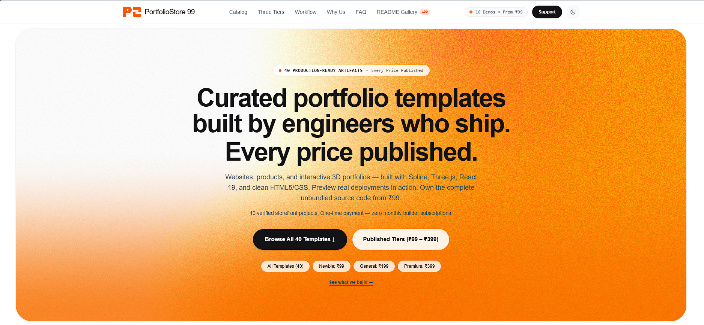

# PortfolioStore 99 — Promotional Documentation & Architecture Specification

[](https://www.portfoliostore99.in)
[](https://www.portfoliostore99.in/#catalog)
[](https://www.portfoliostore99.in/#pricing-units)
[](https://vercel.com)



*Official storefront preview of [PortfolioStore 99](https://www.portfoliostore99.in) — Production-ready developer portfolio templates starting at ₹99.*

A comprehensive architectural specification, product catalog, brand design system, and marketing blueprint for **PortfolioStore 99** ([portfoliostore99.in](https://www.portfoliostore99.in)), the digital storefront for production-ready, unbundled developer portfolio templates.

> **Repository Notice:** This repository contains official promotional planning, architectural specifications, and marketing documentation for PortfolioStore 99. It does **not** house the production storefront application, which is securely maintained in a separate private repository.

---

## Table of Contents

- [Quick start](#quick-start)
- [1. Executive Summary](#1-executive-summary)
- [2. Mission & Value Proposition](#2-mission--value-proposition)
- [3. Verified Product Catalog & Live Previews](#3-verified-product-catalog--live-previews)
- [4. Pricing Tiers & Economics](#4-pricing-tiers--economics)
- [5. How the Store Works](#5-how-the-store-works)
- [6. Intended Customer Audiences](#6-intended-customer-audiences)
- [7. Production Technology & Services](#7-production-technology--services)
- [8. Brand & Design System](#8-brand--design-system)
- [9. Official Policies & Customer Trust](#9-official-policies--customer-trust)
- [10. Documentation Index](#10-documentation-index)
- [11. Architectural Boundaries](#11-architectural-boundaries)
- [12. Implementation Status](#12-implementation-status)
- [13. License & Proprietary Rights](#13-license--proprietary-rights)

---

## Quick start

Follow this step-by-step customer walkthrough to browse, purchase, customize, and launch your developer portfolio with **[PortfolioStore 99](https://portfoliostore99.in)**:

### 1. Browse Templates

Visit [https://portfoliostore99.in](https://portfoliostore99.in) and explore the available portfolio templates and live demos.
- Browse the verified catalog of 11 developer portfolio templates across diverse visual aesthetics, including clean single-page starter layouts, 3D Spline interactive scenes, Three.js isometric workspaces, retro CRT terminals, and macOS-style desktop environments.
- Click the **Live Demo** button on any template to launch its production deployment on Vercel. You can test interactive 3D physics, theme toggles, audio visualizers, and mobile responsiveness directly on your device before purchasing.

### 2. Choose & Purchase

Select a suitable template and pricing tier matching your experience level and project requirements:

- **Newbie: ₹99** — Clean, ultra-fast starter portfolios (e.g., [Outlet](https://www.portfoliostore99.in/templates/store-outlet)) designed for minimal footprint and maximum clarity.
- **General: ₹199** — Feature-rich designs featuring interactive 3D Spline models, Three.js rooms, editorial manuscript layouts, or AI chatbot integration (e.g., [Star](https://www.portfoliostore99.in/templates/store-star), [HouseBlue](https://www.portfoliostore99.in/templates/store-houseblue), [Parchment](https://www.portfoliostore99.in/templates/store-parchment)).
- **Premium: ₹399** — Advanced engineering stacks featuring Next.js 15, React 19, GSAP animations, WebGL fluid shaders, retro CRT monitors, or floating 3D island universes (e.g., [Desktop](https://www.portfoliostore99.in/templates/store-desktop), [Neon](https://www.portfoliostore99.in/templates/store-neon), [Typo](https://www.portfoliostore99.in/templates/store-typo), [3d-Home](https://www.portfoliostore99.in/templates/store-3dhome)).

Complete the purchase through the available checkout process:
1. Navigate to the template product page and click **Buy Template** to open the checkout page (`/checkout/[slug]`).
2. Enter your **Full Name** and **Email Address** (used for payment receipt and persistent file access).
3. Complete payment securely via the Razorpay Standard Checkout modal, supporting UPI (Google Pay, PhonePe, Paytm, QR code), Debit/Credit Cards, and Netbanking. All prices are flat one-time fees with zero recurring subscriptions.

### 3. Receive Your Template

Upon successful payment completion and cryptographic verification (HMAC-SHA256):
- **Instant On-Screen Download:** You are immediately redirected to the confirmation page (`/thank-you?order_id=...`) with an **"Access Your Files (Google Drive)"** button for instant download of your template `.zip` package.
- **Automated Email Receipt:** An automated confirmation email is dispatched via Resend to the email address provided during checkout, providing your Order ID, purchase details, and a persistent Google Drive download link for future re-downloads.
- **Source Deliverables:** You receive the full unbundled, unminified source code (React, Next.js, or Vite), modular Tailwind CSS configurations, all static assets and 3D models (where applicable), and template-specific setup instructions.

### 4. Customize Your Portfolio

Extract the downloaded `.zip` archive on your local computer and open the project in your preferred code editor:
1. Review the template's included documentation and README for specific architecture notes and requirements.
2. Install the required dependencies:
   ```bash
   npm install
   ```
3. Launch the local development server:
   ```bash
   npm run dev
   ```
4. Customize personal information, projects, images, skills, and other relevant content:
   - Update your personal bio, headline, and contact details in the designated data or content configuration files.
   - Replace project cards with your real projects, live deployment links, and GitHub repositories.
   - Update technical skills, work experience, education timeline, and resume download links.
   - Replace placeholder avatars and graphic assets with your personal imagery.

### 5. Deploy Your Website

Follow the template-specific deployment instructions and publish your portfolio using a supported hosting provider:
- **Deploy to Vercel (Recommended):** Push your customized project to a personal GitHub repository and import it into [Vercel](https://vercel.com) for automated continuous deployments, or deploy directly via terminal:
  ```bash
  npx vercel
  ```
- **Alternative Hosting:** You can also deploy to supported platforms such as Netlify, Cloudflare Pages, or GitHub Pages based on your template's build configuration.
- **Custom Domain:** Connect your custom personal domain (e.g., `yourname.com`) for free via your hosting dashboard without paying any recurring website builder fees.

---

## 1. Executive Summary

**PortfolioStore 99** is an independent digital storefront operating at [portfoliostore99.in](https://www.portfoliostore99.in).

The platform sells production-tested personal portfolio website templates to software engineers, computer science students, frontend developers, and digital creators. By providing complete, unminified source code packages for flat, accessible one-time fees (starting at **₹99**), PortfolioStore 99 enables developers to launch high-performance personal websites without recurring builder subscriptions or weeks of tedious design work.

---

## 2. Mission & Value Proposition

### The Problem
Traditional website builders (such as Framer, Squarespace, and Webflow) lock developers into proprietary platforms and charge recurring monthly subscriptions of ₹1,200 to ₹3,500+ ($15 to $40/month) simply to keep a custom domain connected. If payments stop, the portfolio vanishes. Meanwhile, generic free templates found on the internet are frequently unmaintained, lack modern interactive UI (Three.js 3D scenes, shaders, terminal CLIs), and offer no live preview deployments or setup guidance.

### The PortfolioStore 99 Solution
1. **100% Unbundled Code Ownership:** Customers own every file (React, Next.js, Vite, Three.js, Tailwind CSS) and can host it for **free forever** on Vercel, Netlify, or GitHub Pages.
2. **Flat One-Time Pricing:** Starting at ₹99 flat (~$1.99 USD). Zero monthly subscriptions, zero vendor lock-in.
3. **Verified Live Deployed Previews:** Every template is deployed live on Vercel so visitors can test 3D physics, responsive layouts, and themes before spending a rupee.
4. **Frictionless Domestic Payments:** Native Razorpay Standard Checkout supporting UPI QR, Google Pay, PhonePe, Paytm, Debit/Credit Cards, and Netbanking.
5. **Instant Automated Delivery:** Instant Google Drive download link on screen and automated email receipt via Resend.
6. **Direct Developer Support:** Dedicated support via WhatsApp (`@ayushcmd`) and email (`portfoliostore99@gmail.com`).

---

## 3. Verified Product Catalog & Live Previews

The platform features **11 verified portfolio templates**, each running a live interactive deployment on Vercel:

| Template | Category | Price (INR) | Primary Stack | Live Demo | Storefront Link |
|---|---|---:|---|---|---|
| **Outlet** | Newbie | ₹99 | React, Tailwind CSS, Vite | [Live Demo](https://store-outlet.vercel.app) | [View Product](https://www.portfoliostore99.in/templates/store-outlet) |
| **Star** | General | ₹199 | Spline 3D, Three.js, React, FastAPI | [Live Demo](https://store-star.vercel.app) | [View Product](https://www.portfoliostore99.in/templates/store-star) |
| **HouseBlue** | General | ₹199 | Three.js, WebGL Canvas, Pixel Art | [Live Demo](https://store-houseblue.vercel.app) | [View Product](https://www.portfoliostore99.in/templates/store-houseblue) |
| **Parchment** | General | ₹199 | React, Tailwind, Editorial Serif | [Live Demo](https://store-parchment.vercel.app) | [View Product](https://www.portfoliostore99.in/templates/store-parchment) |
| **Desktop** | Premium | ₹399 | React 19, Framer Motion, macOS Dock | [Live Demo](https://store-desktop.vercel.app) | [View Product](https://www.portfoliostore99.in/templates/store-desktop) |
| **Neon** | Premium | ₹399 | CRT Shaders, Canvas, Audio Synth | [Live Demo](https://store-neon-tawny.vercel.app) | [View Product](https://www.portfoliostore99.in/templates/store-neon) |
| **Hazebloom** | Premium | ₹399 | WebGL Fluid Shaders, Glassmorphism | [Live Demo](https://store-hazebloom.vercel.app) | [View Product](https://www.portfoliostore99.in/templates/store-hazebloom) |
| **CyanLight** | Premium | ₹399 | Retro CRT Frame, Cyan Cyber Grid | [Live Demo](https://store-cyanlight.vercel.app) | [View Product](https://www.portfoliostore99.in/templates/store-cyanlight) |
| **ArtCraft** | Premium | ₹399 | Next.js, Three.js R3F, 3D Desk View | [Live Demo](https://store-artcraft.vercel.app) | [View Product](https://www.portfoliostore99.in/templates/store-artcraft) |
| **Typo** | Premium | ₹399 | Next.js 15, React 19, GSAP, Orbit Rings | [Live Demo](https://store-typo.vercel.app) | [View Product](https://www.portfoliostore99.in/templates/store-typo) |
| **3d-Home** | Premium | ₹399 | Three.js, GSAP, Draco GLTF, Audio | [Live Demo](https://store-3dhome.vercel.app) | [View Product](https://www.portfoliostore99.in/templates/store-3dhome) |

---

## 4. Pricing Tiers & Economics

PortfolioStore 99 categorizes products into three distinct tiers:

```
┌─────────────────────────────────┐   ┌─────────────────────────────────┐   ┌─────────────────────────────────┐
│          NEWBIE TIER            │   │          GENERAL TIER           │   │          PREMIUM TIER           │
│             ₹99                 │   │             ₹199                │   │             ₹399                │
│       Flat One-Time Fee         │   │       Flat One-Time Fee         │   │       Flat One-Time Fee         │
├─────────────────────────────────┤   ├─────────────────────────────────┤   ├─────────────────────────────────┤
│ • Clean, single-page layout     │   │ • 3D Spline / Three.js rooms    │   │ • Next.js 15 & React 19 stacks  │
│ • Ultra-fast load times         │   │ • Interactive blog engines      │   │ • Complex WebGL fluid shaders   │
│ • Minimal bundle footprint      │   │ • Editorial book codex themes   │   │ • Draggable macOS desktop UI    │
│ • Perfect for early students    │   │ • AI chatbot integrations       │   │ • Orbiting GSAP tech rings      │
└─────────────────────────────────┘   └─────────────────────────────────┘   └─────────────────────────────────┘
```

---

## 5. How the Store Works

```
Explore Catalog  ──▶  Live Vercel Preview  ──▶  Razorpay Checkout  ──▶  Instant Drive Download
(11 Templates)        (Test 3D & Mobile)        (UPI, Cards, Banks)      (Zip Archive & Email)
```

1. **Explore & Filter:** Browse templates on [portfoliostore99.in](https://www.portfoliostore99.in) by price tier or aesthetic.
2. **Live Deployed Preview:** Open real, interactive deployments on Vercel to inspect animations, theme toggles, and mobile responsiveness.
3. **Frictionless Checkout:** Click "Buy Template", enter your Name and Email, and authorize payment via Razorpay.
4. **Cryptographic Verification:** Server verifies the transaction via HMAC-SHA256 and logs the order in Neon PostgreSQL.
5. **Instant Delivery:** Receive immediate on-screen access to the secure Google Drive download link plus an automated email receipt via Resend.
6. **Launch:** Unzip the codebase, update your resume data, and deploy to Vercel for free in under 15 minutes.

---

## 6. Intended Customer Audiences

- **CS & Engineering Students:** Fast, budget-friendly portfolio setup for placements and internship applications.
- **Junior & Self-Taught Developers:** Proving frontend mastery with interactive 3D, WebGL, and terminal interfaces.
- **Senior & Full-Stack Engineers:** Upgrading professional branding without burning weekends on UI design.
- **Freelancers & Consultants:** High-impact digital rooms and case study presentations for client conversion.

---

## 7. Production Technology & Services

The authoritative storefront operates on the following production stack:

- **Web Framework:** Next.js 14 App Router (React 18, Tailwind CSS)
- **Hosting & Edge Delivery:** Vercel Global Edge Network
- **Database:** Neon Serverless PostgreSQL (`orders` table)
- **Payment Processing:** Razorpay Standard Checkout (UPI QR, Cards, Netbanking)
- **Transactional Email:** Resend
- **Digital Storage & Fulfillment:** Google Drive
- **Production Repository:** `https://github.com/ayushcmdx/PortfolioStore` (Private)

---

## 8. Brand & Design System

- **Primary Brand Accent:** Vibrant Digital Orange (`#FE5116`)
- **Foundational Surfaces:** Deep Black (`#000000` / `#0D0D11`) and Pure White (`#FFFFFF`)
- **Typography Scale:**
  - Headings: `Plus Jakarta Sans`
  - Body Copy: `IBM Plex Sans` / `Inter`
  - Technical / Code: `IBM Plex Mono`
- **Design Philosophy:** Restrained, modern digital product aesthetic; zero tacky gradients or emoji clutter; high contrast; accessible focus rings.

---

## 9. Official Policies & Customer Trust

All purchases are governed by published terms on the official storefront:

- **Refund Policy ([/refund-policy](https://www.portfoliostore99.in/refund-policy)):** Due to the unbundled digital nature of source code files, refunds are not offered after delivery. However, customers have a **fair one-time replacement option within 7 days** to swap templates by paying 50% of the new template's listed price. Defective or corrupted files are fixed/replaced free of charge.
- **Terms of Service ([/terms](https://www.portfoliostore99.in/terms)):** Single-user, perpetual license for personal branding and client projects. Reselling or distributing the raw source code as a template is strictly prohibited.
- **Privacy Policy ([/privacy-policy](https://www.portfoliostore99.in/privacy-policy)):** Collects only name, email, and order metadata. Zero payment credentials stored. Zero advertising cookies.
- **Direct Support:**
  - **Email:** `portfoliostore99@gmail.com`
  - **WhatsApp:** `https://wa.me/917587246554` (`@ayushcmd`)

---

## 10. Documentation Index

The `docs/` directory contains in-depth documentation covering all aspects of the business and future promotional landing page:

| Document | Purpose |
|---|---|
| [**Business Overview**](docs/business-overview.md) | Problem analysis, market positioning, target audience, and business facts. |
| [**Product Catalog**](docs/product-catalog.md) | In-depth specifications, features, stacks, and links for all 11 templates. |
| [**Customer Journey**](docs/customer-journey.md) | Step-by-step user flow, checkout architecture, HMAC verification, and delivery. |
| [**Brand & Design System**](docs/brand-and-design-system.md) | Color tokens, typography, logo guidelines, and UI component standards. |
| [**Promotional Page Specification**](docs/promotional-page-specification.md) | Complete section-by-section wireframe, copywriting, and layout blueprint. |
| [**Policies & Customer Trust**](docs/policies-and-customer-trust.md) | Published legal terms, replacement rules, privacy standards, and support. |
| [**Technology & Services**](docs/technology-and-services.md) | Infrastructure architecture, production registry, and security boundaries. |
| [**SEO & AI Discovery**](docs/seo-and-ai-discovery.md) | Meta tags, Open Graph, Schema.org JSON-LD, and AI crawler optimization. |
| [**Implementation Checklist**](docs/implementation-checklist.md) | Complete pre-implementation verification and future coding milestones. |
| [**Asset Inventory**](assets/README.md) | Catalog preview images, logo specifications, and graphic assets. |

---

## 11. Architectural Boundaries

To ensure operational stability and security:
- This repository is dedicated to **promotional documentation and specifications**.
- The future promotional website is a **presentation layer only**. It must link to `https://www.portfoliostore99.in` for all browsing and purchasing.
- Under no circumstances should checkout, Razorpay keys, database connections, or Google Drive download URLs be exposed or recreated in promotional projects.

---

## 12. Implementation Status

- [x] Comprehensive business model documentation
- [x] Complete 11-template catalog verification
- [x] Brand identity and design system specification
- [x] Full promotional landing page blueprint
- [x] Customer journey and HMAC verification documentation
- [x] Legal policies and trust guidelines
- [x] SEO, Schema.org, and AI discovery recommendations
- [ ] **Promotional Website Implementation:** Pending separate authorization.

---

## 13. License & Proprietary Rights

This repository contains official promotional documentation, architecture specifications, branding materials, visual assets, and product descriptions for **PortfolioStore 99**.

> **Important Licensing Notice:**  
> This is a promotional and documentation repository — **it is NOT an open-source codebase**, and its contents are **not** licensed under open-source terms (such as MIT or Apache). Public visibility on GitHub does not grant permission to copy, adapt, reproduce, redistribute, or commercially exploit any materials, documentation, screenshots, or branding contained herein.
>
> Furthermore, this repository does **not** grant any rights or licenses to the private PortfolioStore 99 application source code, commercial portfolio templates, customer materials, or commercial products. Third-party trademarks, services, and libraries referenced herein remain the property of their respective owners.

For full legal terms, restrictions, and inquiries, please review the root [LICENSE](LICENSE) file. For questions or written permissions, contact [`portfoliostore99@gmail.com`](mailto:portfoliostore99@gmail.com).

---

*© 2026 PortfolioStore 99. Official Promotional Project Specification.*
